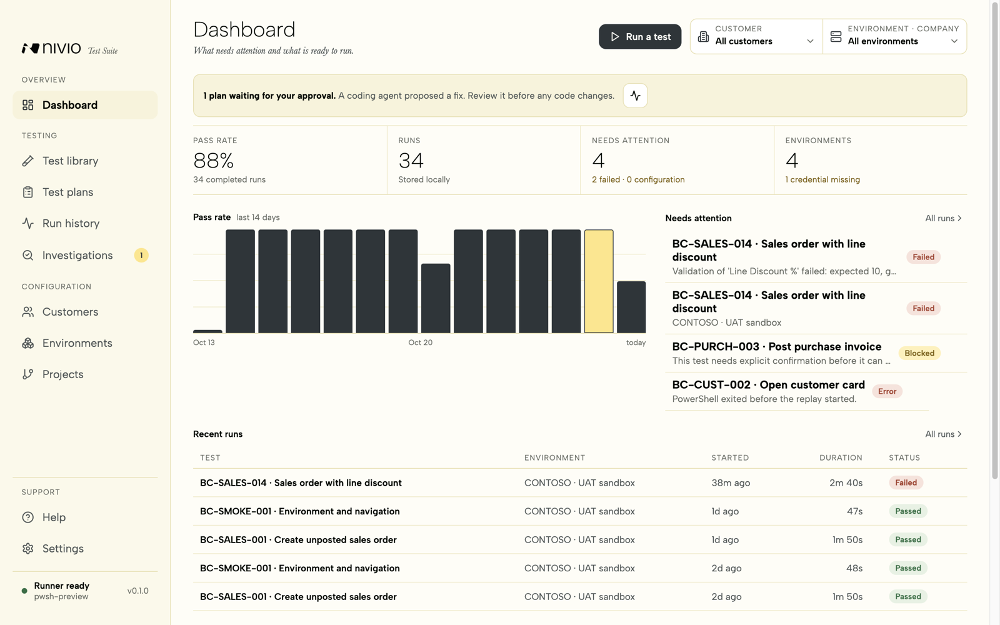
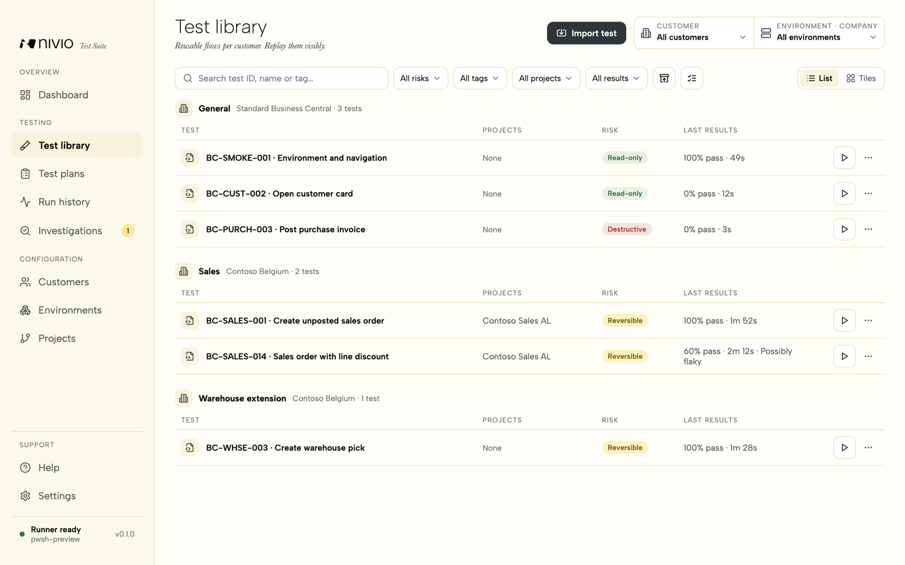
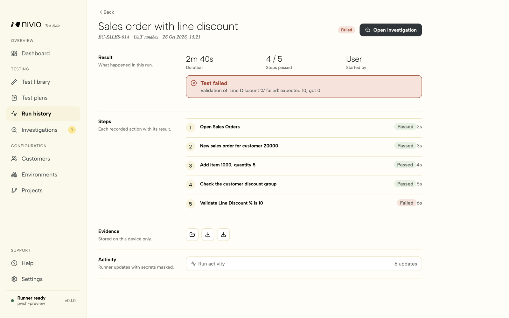
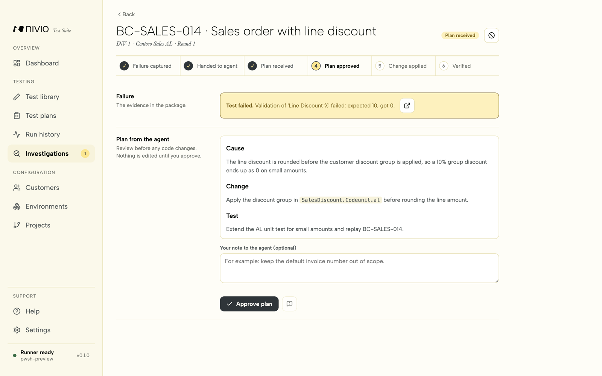
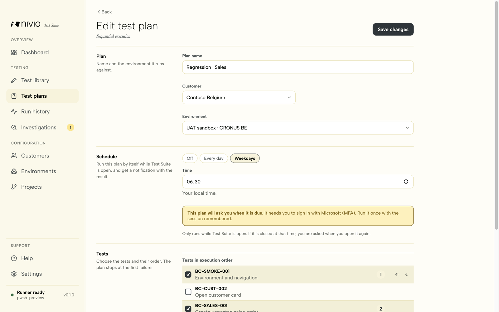
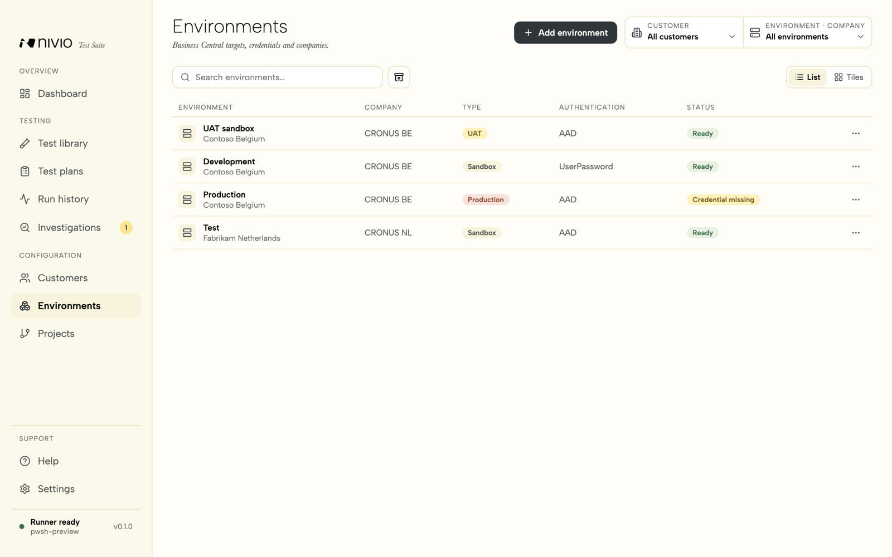

# NIVIO Test Suite

NIVIO Test Suite is an open-source macOS and Windows application for importing,
recording, editing and visibly replaying Microsoft Dynamics 365 Business Central
Page Script recordings.

The MVP combines an Electron/React user interface with Microsoft's pinned
`@microsoft/bc-replay` runner and Playwright reports. Production runs are blocked
by default.

> [!WARNING]
> **Provided as is.** NIVIO Test Suite is provided "as is", without warranty of any kind.
> NIVIO BV is not responsible or liable for any problem, damage or loss that results from
> using it, including changed or lost Business Central data, incorrect test results or
> exposed information. You use the application at your own risk. Run it against sandbox or
> UAT environments only, and review every test before you run it. See sections 7 and 8 of
> the [Apache License 2.0](LICENSE).



## Screenshots

All screens show sample data.

| | |
|---|---|
|  |  |
| **Test library.** Reusable tests per customer, with risk, linked projects and pass rate. | **Run results.** Every step with its result, the error and the local evidence. |
|  |  |
| **Failure investigations.** A coding agent proposes a fix; nothing changes until you approve. | **Test plans.** Ordered tests for one environment, run by hand or on a schedule. |
|  | |
| **Environments.** Sandbox and UAT targets per customer; production stays blocked. | |

## Current capabilities

- Configure customers, tenants, sandbox/UAT environments and companies.
- Organize reusable tests in a global General group and customer-specific application groups.
- Save ordered test plans per Business Central environment and stop automatically on the first failed test.
- Assign reusable parameter profiles per test-plan item and complete missing or secret values in one preflight form.
- Validate complete test plans before execution and export grouped results as Markdown or JSON.
- Switch lists between list and tile views; the choice is remembered per page.
- Store AAD/UserPassword credentials with Electron `safeStorage`.
- Import and validate Page Script YAML recordings.
- Import relative Page Script include bundles and preserve their directory structure.
- Safely update an existing Page Script recording after reviewing its version, step, include, and parameter changes; historical runs keep their original version.
- Extract script parameters and create run-specific YAML copies.
- Launch `bc-replay` in visible `-Headed` mode.
- Stream local runner output into the desktop UI.
- Filter run history and remove individual runs with their local evidence.
- Filter runs by every runner status, customer, source and period, rerun safely, and compare a run with the latest passing baseline.
- Keep a persistent customer and environment working context across the library, plans, runs, and run setup.
- Filter the test library by risk, type, tag, latest result, and maintenance state, then create a plan from selected tests.
- Show per-test pass rate, average duration and a possible-flakiness indication.
- Surface failed, blocked, and technical-error runs plus workspace maintenance signals directly on the dashboard.
- Save reusable non-secret parameter profiles for individual tests.
- Keep parameter profiles in the validated workspace state so they are recoverable and portable; secret parameter values are always excluded.
- Check Business Central endpoint reachability without executing a test.
- Archive and restore customers, groups, environments, tests and plans without losing their definitions or run history.
- Export and import a portable `.nivio-workspace` backup without credentials, sessions, runs or evidence.
- Apply configurable retention to standalone run evidence while preserving test-plan history.
- Recover local configuration from the last valid backup when the primary state is unreadable.
- Stop an active runner process.
- Store run history, result directories and Playwright-report links.
- Export sanitized run summaries as Markdown or JSON.
- Mask secret parameters and replay credentials from persisted logs.
- Block production and require confirmation for write-capable tests.
- Persist a sanitized audit of approved, rejected and failed AI-agent requests.

## Prerequisites

For development:

- Bun 1.3 or a compatible Node/npm setup
- Dependencies installed with `bun install`

For actual Page Script replay:

- macOS 13+ or Windows 10/11
- PowerShell 7 stable (`pwsh`) or preview (`pwsh-preview`)
- Node/npm with `npx` available on `PATH`
- Network access to the target Business Central environment
- A test account compatible with the selected `bc-replay` authentication mode
- Business Central permission set `PAGESCRIPTING - PLAY` or equivalent

Microsoft currently documents BC Replay for Windows PowerShell. The current
PowerShell-based runner is adapted through a small macOS compatibility wrapper;
keep Windows as the fallback for authoritative CI runs.

## Development

```bash
bun install
bun run dev
```

## Menu and shortcuts

The application menu mirrors the screens and main actions: **Go** (⌘1 to ⌘8, ⌘K for search),
**File** (import a test, new items, workspace export and import), **Run** (stop the active run),
**View** (text size) and **Help** (Help page, shortcuts, open the data folder). Without the menu:
`G` then a letter goes to a screen, `N` starts a new item, `/` focuses the search box and `?`
lists every shortcut. In a development run on macOS the menu bar says "Electron"; a packaged
build says "NIVIO Test Suite". The app was called NIVIO Test Studio before; a packaged
build keeps its data folder under that old name, so nothing moves.

## AI agent access through MCP

NIVIO Test Suite exposes a local MCP server for Codex and Claude Desktop. The
Electron app must be running: the MCP process connects to an authenticated
loopback bridge and never reads `state.json`, credentials, or session storage
directly.

Open **Settings → AI agent access** and copy the configuration for the desired
client:

- Codex: add the copied TOML to `~/.codex/config.toml` or a trusted project's
  `.codex/config.toml`, then restart Codex.
- Claude Desktop: merge the copied JSON into the local developer MCP
  configuration, then restart Claude Desktop.

The agent can list and inspect Business Central tests, validate standalone Page
Script YAML, request creation of a new test, request a visible run, stop a run,
and read sanitized results. Creating, starting, and stopping always remains
pending until a user approves the request on the **Dashboard**. Production
remains blocked. Runs started through MCP are labelled **AI agent** in **Run
history**. Screenshots, video, and the full Playwright report remain local and
can be opened there.

MCP-created scripts are new, standalone Business Central Page Script YAML files.
The agent cannot overwrite existing tests, read
credentials, or return local artifact paths.

Quality checks:

```bash
bun run typecheck
bun run lint
bun run test
bun run build
```

Create the Windows installer on a Windows build agent:

```powershell
bun run package:win
```

The output is written to `release/`.

Create the macOS DMG and ZIP on a Mac:

```bash
bun run package:mac
```

The unsigned development build can be opened through Finder's context menu with
**Open**. Distributed builds should use Apple Developer ID signing and
notarization with your own certificates.

### Continuous integration and releases

GitHub Actions runs two workflows:

- **CI** (`.github/workflows/ci.yml`) runs typecheck, lint, tests and the build on
  Linux, and the tests on macOS and Windows, for every pull request and every push to
  `main`.
- **Release** (`.github/workflows/release.yml`) runs on a version tag. It repeats the
  CI checks, builds the macOS DMG/ZIP and the Windows installer, and attaches them to
  a **draft** GitHub release. Nothing is published until a maintainer reviews and
  publishes the draft.

To release a new version:

1. Set `version` in `package.json` (for example `0.2.0`) and merge it to `main`.
2. Tag that commit and push the tag:

   ```bash
   git tag v0.2.0
   git push origin v0.2.0
   ```

3. Review the draft release on GitHub, test the installers, then publish it.

The workflow stops when the tag does not match `package.json`. It can also be started
by hand from the Actions tab; that run keeps the installers as workflow artifacts and
creates no release.

Builds are unsigned by default. To sign them, add these repository secrets:
`MAC_CSC_LINK` and `MAC_CSC_KEY_PASSWORD` (Developer ID certificate),
`WIN_CSC_LINK` and `WIN_CSC_KEY_PASSWORD` (Windows code-signing certificate), and for
macOS notarization `APPLE_ID`, `APPLE_APP_SPECIFIC_PASSWORD` and `APPLE_TEAM_ID`.

## First run

1. Open **Environments** and add a customer sandbox or UAT environment.
2. Select the correct authentication mode.
3. Store a dedicated test credential when AAD or UserPassword is used.
4. Open **Test library** and import a YAML recording saved from BC Page Scripting.
5. Select the test, review parameters and risk, then choose **Run visibly**.
6. Review live output and open the result folder or Playwright report afterward.

Application data is stored in Electron's OS-specific user-data directory, shown
under **Settings → Runtime diagnostics**. Credentials are kept separately from
the main state file.

### Projects and failure investigations

A **project** is the local AL code behind one environment. Tests link to one or more
projects (Test library → Edit test → Projects, or the project page). Projects are
sandbox/UAT only; the code folder stays on this device and is never part of a backup.

When a test fails, open the run and choose **Create investigation**. Test Suite builds a
package from the run (steps, masked log, Page Script, optional screenshots and video, project
context and an agent brief) and you hand it to your coding agent:

1. **Copy prompt** and paste it into Claude Code, Codex or another agent in the project folder.
   **Export into project** copies the package into `<repo>/.nivio/investigations/` (add
   `.nivio/` to `.gitignore`) for agents that cannot read outside the repository.
2. The agent writes `plan.md` into the agent folder. Choose **Check for the agent's plan**,
   review it, then **Approve plan** or **Request changes**.
3. After approval the agent changes the code on a branch (`fix/<test id>-<round>`), commits
   locally and writes `change.json`. Import it, or record the change yourself.
4. You publish to the sandbox and start the retest. A passing retest verifies the
   investigation; a failing one starts a new round with fresh evidence.

Nothing is pushed, published or run without you.

### Workspace backup

Use **Settings → Workspace backup** to export all reusable configuration and
test definitions to a `.nivio-workspace` file. The backup deliberately excludes credentials, remembered Microsoft sessions,
run history and evidence. Import can merge objects by ID or replace the reusable
workspace while keeping local secrets and run evidence untouched.


## Security model

- Production is default-deny in both import metadata and runtime validation.
- Renderer code has no Node or direct filesystem access.
- IPC inputs are validated with Zod in the main process.
- Credentials are encrypted by the operating-system service through
  `safeStorage` and injected only into the child-process environment.
- The runner is a separate process and can be terminated as a process tree.
- Imported recordings cannot supply arbitrary shell commands.
- Run-specific parameter values are materialized in a copied YAML file; the
  original recording stays unchanged.
- Business Central network targets are restricted to
  `businesscentral.dynamics.com` and localhost by default. Approved HTTPS hosts
  can be added through the comma-separated `BCFT_ALLOWED_BC_HOSTS` environment
  variable.
- Text reports and replay artifacts are sanitized for known credentials and
  common secret patterns after a run completes.
- Local state carries a schema version and is migrated atomically while retaining
  the previous file as a rollback backup.

### Replay runtime compatibility and updates

**Settings → Runtime diagnostics** shows the active and bundled `bc-replay` versions,
the runtime source, compatibility state, and whether rollback is available. **Check
runtime** repeats the local prerequisite and package-integrity checks. On macOS the UI
also states that Windows remains the authoritative replay fallback.

Runtime updates are explicit and offline: **Install approved package** accepts a local
`.nivio-runtime` ZIP selected by the user. It never downloads or executes an update in
the background. The archive must contain `manifest.json`, the declared replay script,
and all runtime files beneath relative paths. The manifest format is:

```json
{
  "version": 1,
  "replayVersion": "0.1.139",
  "appVersions": ["0.1.0"],
  "platform": "win32",
  "replayScript": "node_modules/@microsoft/bc-replay/Replay.ps1",
  "workingDirectory": ".",
  "checksums": {
    "node_modules/@microsoft/bc-replay/Replay.ps1": "<sha256>"
  },
  "executablePaths": []
}
```

Every file except the manifest must have a matching SHA-256 checksum. Native binaries
that require execute permission on macOS must also be named in `executablePaths`.
Packages with traversal paths, undeclared or modified files, excessive size, the wrong
platform, or an unapproved application version are rejected. The previous managed
runtime is retained as one rollback generation. Runtime changes are blocked during a
run.

## Known MVP limitations

- TOTP/certificate MFA parameters exposed by newer `bc-replay` versions are not
  wired into the UI yet.
- AAD interactive login in an existing browser profile is not implemented.
- Live progress is derived from runner output rather than a stable step-events
  API from Microsoft.
- Git synchronization and Azure DevOps publishing are not implemented.
- Signed and notarized release distribution still requires NIVIO release certificates.
- Control add-ins and UI outside Business Central remain outside Page Scripting's
  supported scope.

## Contributing and security

See [CONTRIBUTING.md](CONTRIBUTING.md) for the development workflow and the checks a
pull request must pass. Report vulnerabilities privately as described in
[SECURITY.md](SECURITY.md), never in a public issue.

## License

NIVIO Test Suite is licensed under the [Apache License 2.0](LICENSE). See
[NOTICE](NOTICE) for attribution.

"NIVIO", the NIVIO logo and the application icon are trademarks of NIVIO BV and are not
licensed under the Apache License 2.0. You may use the code, but forks and
redistributed builds must use their own name and logo and must not suggest that NIVIO
endorses them.
